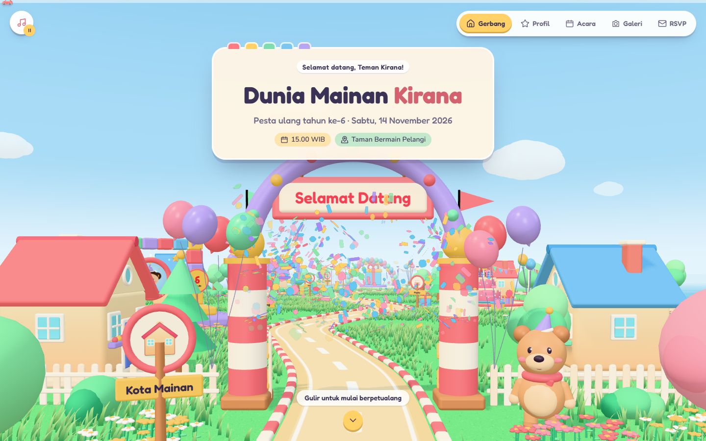
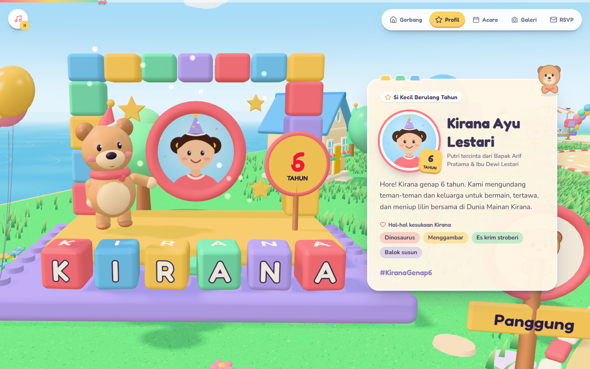
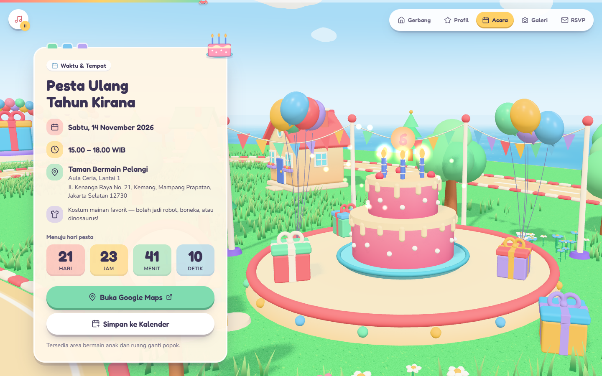
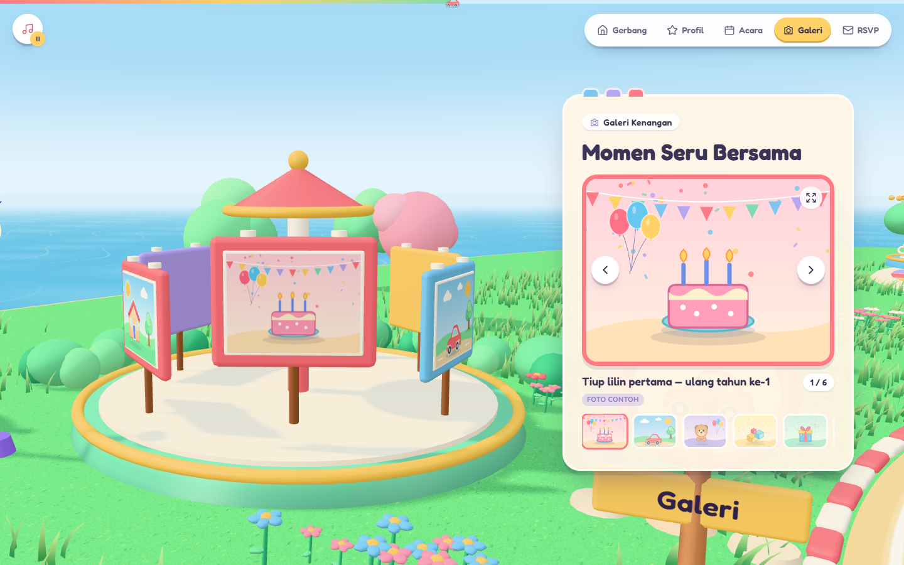
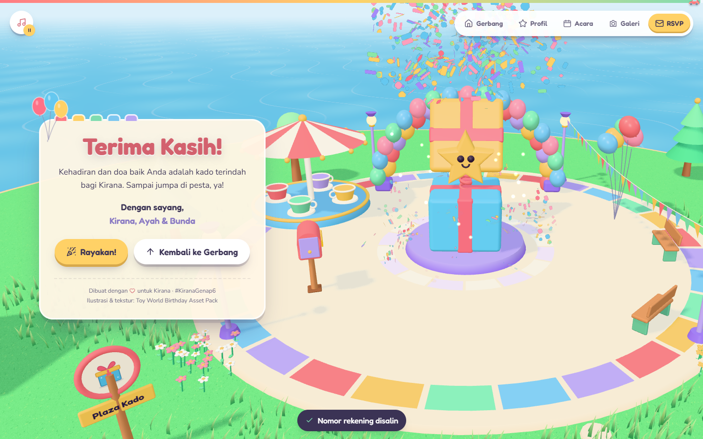
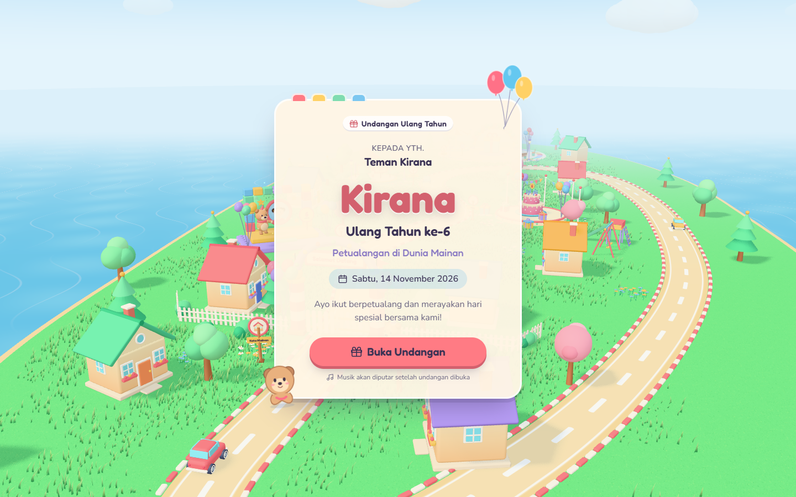

# Toy World Birthday — Interactive 3D Invitation

An interactive children's birthday invitation built as a **React + TypeScript** application. Guests open the invitation at a toy-town gate, and scrolling then flies the camera across a miniature island with five stops: the gate, a toy-block birthday stage, a party garden with a giant cake, a photo carousel, and a party plaza where they can RSVP and open a digital gift.

| Entrance | Birthday stage | Party garden |
| --- | --- | --- |
|  |  |  |
| **Photo carousel** | **Plaza finale** | **Cover** |
|  |  |  |

Mobile layouts: [part 1](docs/screenshots/mobile-1.png) · [part 2](docs/screenshots/mobile-2.png)

## Quick start

Requires **Node.js 20.19+** (or 22.12+) and npm.

```bash
npm install
npm run dev        # http://localhost:5173
npm run build      # type-check + production build into dist/
npm run preview    # serve the production build
```

`dist/` is a static site and can be hosted on any static host (Netlify, Vercel, GitHub Pages, S3, …). For a sub-path deployment, set Vite's `base` option. All asset URLs are built from `import.meta.env.BASE_URL`.

## Personalising the invitation

All birthday content is in **`src/config/invitation.config.ts`**. Components never hard-code details.

| Field | What it controls |
| --- | --- |
| `child` | Full name, nickname (also spelled out on the 3D letter blocks), age (sets the candle count and badge), portrait, parents line, favourite things |
| `invitation` | Cover texts, welcome message, hashtag, closing message, signature, guest URL parameter |
| `event` | Start/end time as ISO strings **with offset** (e.g. `2026-11-14T15:00:00+07:00`), time zone, venue, address, Google Maps URL, dress code |
| `gallery` | Imported from `src/data/gallery.ts` |
| `rsvp` | `endpoint` (or `null` for demo mode), max companions, deadline, wish length, attendance options |
| `digitalGift` | Enable/disable, message, bank / e-wallet accounts, shipping address |
| `music` | `src` of a licensed audio file, or `null` to use the built-in generated music box |
| `theme` | Sky, coral, butter, mint, lavender, cream and ink colours, used by both the CSS tokens and the 3D palette |
| `showDemoNotices` | Shows "Contoh" (example) badges next to placeholder data. Set to `false` for the real invitation. |

**Personal links:** add `?to=Budi%20Santoso` to the URL. The cover then greets that guest and the RSVP name field is pre-filled.

**Photos:** put files in `public/assets/gallery/` and list them in `src/data/gallery.ts` (`src`, `alt`, `caption`). Remove `demo: true` from real photos. The bundled `memory-0X.svg` files and `portrait-kirana.svg` are illustrated placeholders built from the asset pack; regenerate them with `npm run generate:gallery`.

**Music:** add a track you own or have a licence for to `public/assets/audio/` and set `music.src: projectAsset('audio/your-track.mp3')`. Playback only starts after the guest taps **Buka Undangan** or the music button.

## RSVP: demo mode and backend integration

`src/services/rsvpService.ts` defines an `RsvpService` interface.

- **Demo mode** (`rsvp.endpoint: null`, the default): answers and wishes are saved in this browser's `localStorage` only. The form says so clearly ("Mode demo … tidak dikirim ke server"), and the success message never claims the organiser received anything.
- **Remote mode**: set `rsvp.endpoint` to your API URL.
  - `POST` with JSON `{ name, attendance: "hadir" | "tidak" | "ragu", companions, wish, submittedAt }`. Any 2xx response counts as success.
  - `GET` on the same URL may return `Wish[]` (`{ id, name, attendance, wish, submittedAt }`) for the wishes wall.

  A serverless function, Google Apps Script, Supabase or Airtable proxy all fit this contract.

## Project structure

```text
toy-world-birthday/
├── public/
│   ├── assets/
│   │   ├── illustrations/   ← asset pack SVGs (unchanged)
│   │   ├── textures/        ← asset pack grass maps (unchanged)
│   │   ├── sprites/         ← asset pack confetti + soft particle (unchanged)
│   │   ├── ui/              ← asset pack UI icons (unchanged)
│   │   ├── gallery/         ← demo photos + portrait (replace these)
│   │   ├── audio/           ← put licensed music here
│   │   └── asset-manifest.json
│   └── models/              ← optional licensed .glb models (none supplied)
├── scripts/generate-demo-gallery.mjs
├── src/
│   ├── App.tsx, main.tsx
│   ├── config/
│   │   ├── invitation.config.ts   ← edit me
│   │   ├── assets.ts              ← single asset map (no hard-coded paths elsewhere)
│   │   ├── journey.ts             ← camera stops ↔ sections ↔ panel sides
│   │   └── world.ts               ← island layout, camera waypoints, obstacles
│   ├── data/gallery.ts
│   ├── types/invitation.ts
│   ├── store/                     ← tiny shared store, journey values, celebration events
│   ├── hooks/                     ← useScrollCamera, useCountdown, useReducedMotion, useMusic, …
│   ├── services/rsvpService.ts
│   ├── audio/audioEngine.ts       ← file playback + generated music box + interaction sounds
│   ├── utils/                     ← formatting, clipboard, .ics export, device tier, scroll lock
│   ├── styles/index.css           ← Tailwind v4 theme tokens + toy UI components
│   └── components/
│       ├── invitation/            ← InvitationCover, BirthdayProfile, EventDetails,
│       │                            MemoryGallery, RSVPSection, DigitalGift, ThankYou, Lightbox
│       ├── layout/                ← StopBlock, TopBar, LoadingScreen, StaticWorldFallback, …
│       ├── ui/                    ← ToyCard, PackIcon, Toast, ErrorBoundary
│       └── scene/
│           ├── ToyWorldCanvas.tsx, ToyWorldEnvironment.tsx, CameraRig.tsx, SceneLights.tsx
│           ├── ToyHouse.tsx, ToyTree.tsx, WindyGrass.tsx, Flowers.tsx, BirthdayCake.tsx,
│           │   GiftBox.tsx, Mascot.tsx, ToyCar.tsx, Balloons.tsx, Bunting.tsx, Confetti.tsx, …
│           ├── worlds/            ← EntranceWorld, BirthdayProfileWorld, EventPartyWorld,
│           │                        MemoryGalleryWorld, RSVPAndGiftWorld
│           └── lib/               ← wind field, geometry merging, materials, curves, textures
└── docs/screenshots/
```

## How the 3D journey works

- **One persistent `<Canvas>`.** It is lazy-loaded in its own chunk, so the invitation HTML renders before three.js arrives, and it is fixed behind the scrolling HTML. React state changes never recreate it, and the page creates exactly one WebGL context. 3D text is drawn with Canvas2D for the same reason; drei's `<Text>` would create a second WebGL context.
- **Scroll → camera.** `useScrollCamera` creates a **single master GSAP ScrollTrigger**. Every DOM block with `data-camera-stop` is measured into "hold" and "travel" ranges, and the scroll position becomes a fractional stop index, eased with smootherstep so the camera settles as each panel arrives. The trigger writes only `journey.target`.
- **One camera writer.** `CameraRig` eases `journey.value` toward the target in the render loop and samples two `CatmullRomCurve3`s (position and look-at) built from the explicit waypoints in `config/world.ts`. Because it interpolates a **curve parameter**, fast, reverse and programmatic scrolling all fly along the path and never cut through buildings. The opening shot is a GSAP tween of `journey.intro`, which the rig blends in. Nothing else touches the camera.
- **Direct navigation.** The top navigation (and "Kembali ke Gerbang") scrolls the page with GSAP ScrollToPlugin, and the camera follows the scroll.
- **Responsive framing.** On wide screens a projection view-offset moves the subject beside the HTML panel. On portrait screens it moves the subject above the bottom panel, the field of view widens, and the camera pulls back. The desktop frame is not just shrunk.
- **Collision-safe layout.** In dev, `validateLayout()` samples the camera path (including the portrait pull-back) against every house, tree, sign and focal object, and logs a warning if anything would clip.

## Wind and ambient animation

`scene/lib/wind.ts` defines one travelling gust field, with the same formula in GLSL and TypeScript.

- **Grass:** instanced blades bend in the vertex shader by the gust sampled at each blade's **root**, with bend ∝ height², so roots stay anchored and neighbouring blades move together.
- **Trees, bushes, flowers and flags:** these use a patched `MeshStandardMaterial` whose per-vertex `aWind` weight is 0 on trunks and stems and 1 on canopy tips and flag ends, so trunks stay still.
- **Balloons, clouds and swings:** these sample the same field on the CPU.

Each blade's phase offset is fixed when it is created; nothing is re-randomised per frame.

## Asset pack integration

| Pack asset | Used for |
| --- | --- |
| `textures/grass-basecolor/normal/roughness.png` | Island terrain material (repeat-wrapped, sRGB / linear as appropriate) |
| `sprites/confetti-sprite.png` | 3D confetti (each particle samples a cell of the sheet, spins and tumbles in the shader) and DOM confetti in the 2D fallback |
| `sprites/soft-particle.png` | Floating sparkles and candle glow |
| `illustrations/*.svg` | Wayfinding sign faces in 3D (rasterised to textures), loading screen, card decorations, progress-bar car, illustrated no-WebGL world, gallery/portrait fallback, demo photo generator |
| `ui/*.svg` | Interface icons via `PackIcon` (a CSS mask, so they inherit text colour). Lucide React covers icons the pack lacks. |
| `config/asset-manifest.json` | Copied to `public/assets/asset-manifest.json` |

The SVGs are **not** treated as 3D models. Every 3D object (houses, trees, cake, gifts, bear, cars, blocks, balloons, fences, carousel, …) is built procedurally from rounded primitives, modelled on the pack illustrations' shapes and colours, and merged into single-draw-call geometries with vertex colours. No GLB files were supplied (see `public/models/README.md`).

## Performance

- **Quality tiers** (`utils/device.ts`): high, medium or low. Each sets the DPR cap, shadow-map size, grass and flower density, cloud count and antialiasing. Drei's `PerformanceMonitor` also lowers DPR if frame rate drops.
- **Draw calls:** instancing for grass (chunked for frustum culling), trees, bushes, flowers, curbs, fences, stones, clouds and balloons, plus merged geometry and shared materials. Instanced users of a shared material always carry instance colours so three.js never switches shader programs mid-frame.
- **Shadows:** the sun's shadow frustum follows the camera and is snapped to texels, which keeps it sharp without a huge shadow map.
- **Lazy loading:** gallery photos, the portrait and sign illustrations are rasterised in idle time and uploaded to the GPU before they come into view. Shaders are pre-compiled with `compileAsync` before the loader disappears.
- **Pausing:** rendering stops while the tab is hidden, and music pauses with it.
- **No `backdrop-filter`** over the canvas (re-blurring an animated canvas every frame is very expensive).
- The loading screen shows real progress from the three.js loading manager.

## Accessibility and resilience

- Semantic sections, headings, landmarks and a skip link. Everything essential is plain HTML; nothing depends on clicking 3D objects or on hover.
- Before opening, everything behind the cover is `inert`. After opening, focus moves to the welcome heading.
- **Gallery:** keyboard arrows, swipe, labelled controls, and a lightbox dialog with focus trap, Esc to close and focus restore.
- **RSVP form:** labels, `aria-invalid`/`aria-describedby` errors, live status messages, and focus moved to the first invalid field.
- On small screens, fixed chrome hides while a text field is focused so the keyboard never hides the form.
- **Reduced motion** (OS setting or `?motion=reduce`): the camera cuts between stops instead of travelling, wind is calmed, cars park, idle animations stop, and confetti is minimal.
- **No WebGL** (or `?webgl=off`, a renderer crash, or a failed 3D chunk): an illustrated 2D Toy World built from the pack SVGs replaces the canvas. All content still works.
- **Missing assets:** grass maps fall back to painted ground, sprites to generated textures, and photos and the portrait to pack illustrations. A missing file never takes down the scene.

## QA flags

| URL parameter | Effect |
| --- | --- |
| `?to=Nama Tamu` | Personalised guest name |
| `?quality=low\|medium\|high` | Force a rendering tier |
| `?webgl=off` | Force the 2D fallback |
| `?motion=reduce` | Force reduced motion |

In `npm run dev`, `window.__toyJourney` (camera journey values) and `window.__toyGL` (the renderer) are exposed for automated checks. They are not included in production builds.

## Verified before delivery

These checks were run in headless Chrome (real GPU via ANGLE) against both the dev server and the production build:

- `npm install`, `npm run build` (strict TypeScript) and `npm run dev` all succeed.
- Scroll is locked on the cover. "Buka Undangan" opens the gate, starts music and confetti, and moves focus.
- All five sections (seven camera stops) are reachable by scrolling and by navigation, and the camera settles exactly on each stop.
- Fast reverse scrolling returns the camera along the path to the gate.
- The countdown is live. Map, .ics, gallery (next/prev, thumbnails, lightbox, keyboard), RSVP validation and success, gift reveal and copy-to-clipboard all work.
- Exactly **one** WebGL context, and no console errors.
- Mobile portrait (390×844), phone landscape (844×390, 568×320) and desktop layouts.
- Reduced motion, `?webgl=off` and blocked-asset scenarios.

## Known limitations

- No licensed music ships with the pack, so the default is an original music-box melody generated in the browser.
- Gallery images and the portrait are illustrated placeholders. Replace them with real photos.
- React Three Fiber 9 logs a `THREE.Clock` deprecation warning with three r186. It comes from the library and is harmless.

## Credits

- Illustrations, textures, sprites and UI icons: *Toy World Birthday Invitation Asset Pack* (supplied).
- Fonts: Fredoka and Nunito (SIL Open Font License), self-hosted via Fontsource.
- Built with React, Vite, Three.js, React Three Fiber, Drei, GSAP, Tailwind CSS and Lucide.
